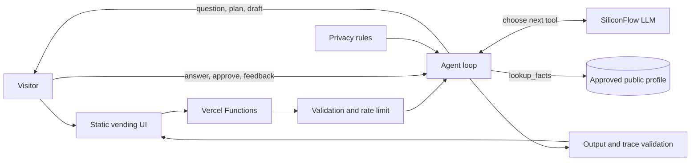

# Zai Vending Machine

A public, privacy-bounded AI experience that turns a visitor's thought into one of three artifacts:

- **Reality Check** — identifies one consequential weakness or hidden assumption.
- **Unexpected Connection** — connects the thought to a distant but defensible concept.
- **Wild Card** — proposes a strange but usable intervention or experiment.

Behind the machine is an **agent**, not a fixed script. The model decides each step from a small toolset: it looks up approved facts, asks the visitor a question when it needs one, proposes a plan (and may recommend a different product), drafts, critiques its own draft, and presents it. The visitor stays in the loop at three checkpoints: answering the agent's questions, approving or correcting its plan, and accepting or sending back the draft. The agent can only read an owner-reviewed public profile; it has no access to private notes, local files, personal memory, or a vector database.

## Architecture



The production deployment contains only:

1. Static assets built from `public/vending/`.
2. `GET /api/vending/status`.
3. `POST /api/vending/turn` for the agent conversation.
4. `POST /api/vending/dispense` as the compatible one-shot endpoint. It does not run the agent.
5. The agent, conversation, generation, privacy, and approved-profile modules under `src/vending/`.

See [docs/vending-architecture.md](docs/vending-architecture.md) for the trust boundary and request lifecycle, or open the [standalone system diagram](docs/system-diagram.html).

## Using the machine

The machine behaves like a small attendant called ZVM-01: deadpan, brief, and plain-spoken. It shows five lamps (SHELF, ORDER, PACK, CHECK, HATCH) while it works and stops at three checkpoints: a question, an order slip, and the packed object.

What you ask decides what it does. These behaviors are the model's judgment, so they are likely, not guaranteed.

| You do this | The machine does this |
| --- | --- |
| Ask about a project or Zai's work ("What is the weakest assumption in CUBIK?") | Checks the shelf first and cites the fact it used |
| Give a vague thought ("Is my idea any good?") | Asks one short question before packing |
| Pick a product that does not fit the question (Wild Card for "what is weak in X?") | Recommends a better product on the order slip. Accept it, or press KEEP to stay with yours |
| Write a clear, specific thought | Skips the question and goes straight to the order slip |
| Type a correction on the order slip ("I meant for a class project") | Re-plans, up to twice |
| Send the packed object back ("too vague", "shorter", "give me something to do this week") | Repacks it, up to twice |
| Try to extract private notes or override the rules | Seals the hatch immediately, with no model call |

Tip: the clearest way to see the agent work is a vague question with a mismatched product, then a pushback on the first draft.

## Requirements

- Node.js 20.19 or newer
- A SiliconFlow API key

## Local development

```bash
npm install
cp .env.example .env
# Add SILICONFLOW_API_KEY to .env
npm run dev
```

Open `http://localhost:3000`.

The development server uses only Node's built-in HTTP and file APIs. It serves the same static interface and calls the same handlers used by Vercel.

## Environment variables

| Variable | Required | Default | Purpose |
| --- | --- | --- | --- |
| `SILICONFLOW_API_KEY` | Yes | — | Authenticates model requests |
| `VENDING_MODEL` | No | `deepseek-ai/DeepSeek-V4-Flash` | Selects the generation model |
| `VENDING_RATE_LIMIT` | No | `60` | Requests allowed per IP in a ten-minute process window |
| `VENDING_STATE_SECRET` | No | `SILICONFLOW_API_KEY` | Signs short-lived, stateless calibration tickets |
| `PORT` | No, local only | `3000` | Local development port |

Never add private vault paths, local indexes, résumé files, contact details, or owner-only credentials to the deployment environment.

## Scripts

| Command | Purpose |
| --- | --- |
| `npm run dev` | Start the local vending server |
| `npm start` | Alias for the local vending server |
| `npm run build` | Build the static Vercel output in `dist/` |
| `npm test` | Run deterministic privacy and contract tests |
| `npm run evaluate` | Run model-backed golden prompt evaluations |

Evaluation filters can be forwarded after `--`:

```bash
npm run evaluate -- --limit 4
npm run evaluate -- --category synthesis
npm run evaluate -- --case synthesis-visual-style --repeat 3
```

See [docs/vending-evaluation.md](docs/vending-evaluation.md) for the full release procedure.

## Public profile

All personal context available to the model lives in [config/public-zai-profile.json](config/public-zai-profile.json). It contains:

- approved behavioral traits;
- bounded public facts about published work, education, and awards;
- approved public source labels and links;
- an explicit list of excluded information.

Updating the résumé, portfolio, or website does not automatically change the application. Review the source manually, remove private or unsupported claims, update the JSON file, and run the complete test and evaluation suites.

## API

### `GET /api/vending/status`

Returns model readiness, profile versions, prompt version, public fact count, and available products. It remains available without a model key so deployment health can be inspected safely.

### `POST /api/vending/dispense`

Request:

```json
{
  "input": "What if a city measured quietness instead of traffic?",
  "product": "unexpected_connection"
}
```

`product` must be one of:

- `reality_check`
- `unexpected_connection`
- `wild_card`

The input must contain between 2 and 1,200 characters. Successful responses include the artifact, version identifiers, and validated behavioral and fact traces.

### `POST /api/vending/turn`

Starts the agent with the same `input` and `product` fields. The response is one of:

- `clarification` — a question the agent chose to ask, with optional choices (human checkpoint);
- `confirmation` with `stage: "plan"` — the agent's reading of the thought and the product it recommends, which may differ from the visitor's choice (human checkpoint);
- `confirmation` with `stage: "draft"` — a self-reviewed draft the visitor can accept or send back (human checkpoint);
- `working` — the agent used its per-request budget and needs a `continue` call, which the browser sends automatically;
- `artifact` — the final validated object, with an `agentLog` of what the agent did.

Follow-up requests return the `stateToken` with an `action`:

| Stage | Actions |
| --- | --- |
| clarification | `answer` (with `answer`), `skip` |
| plan | `dispense` (approve), `keep` (approve but keep the visitor's product), `revise` (with `answer`) |
| draft | `dispense` (accept), `revise` (with feedback in `answer`) |
| working | `continue` |

Tickets expire after 20 minutes. They carry the whole agent state, are signed, and contain no server-side session or private profile data. Limits: two questions, two plan corrections, two rounds of draft feedback, two self-revisions and 20 model calls per session.

## Deployment

Vercel uses `vercel.json` to run `npm run build`, publishes `dist/`, and exposes the three functions in `api/vending/`.

Before deploying:

```bash
npm test
npm run build
```

Set `SILICONFLOW_API_KEY` in the Vercel project for the required environments. `VENDING_MODEL` and `VENDING_RATE_LIMIT` are optional.

## Project structure

```text
.
├── api/vending/                 # Vercel function entry points
├── config/
│   └── public-zai-profile.json  # Only approved personal context
├── docs/                        # Architecture and evaluation guidance
├── public/vending/              # Static interface and visual assets
├── scripts/
│   ├── build-vending.js         # Creates dist/
│   ├── dev-server.js            # Minimal local runtime
│   └── evaluate-vending.js      # Model-backed golden evaluation
├── src/vending/
│   ├── generator.js             # Prompt, product behavior, output validation
│   ├── agent.js                 # Tool-using agent loop, budgets, human pauses
│   ├── conversation.js          # Signed tickets and the visitor-facing turn protocol
│   ├── model-client.js           # Shared SiliconFlow client
│   ├── privacy.js               # Extraction detection and text sanitization
│   ├── public-api.js            # HTTP contracts and rate limiting
│   └── public-profile.js        # Typed access to the approved profile
├── test/
│   ├── vending.test.js
│   └── vending-evaluation-cases.json
└── vercel.json
```

## Security properties and limits

- The runtime does not import a vault reader, retrieval system, vector index, or private profile store.
- Visitor input is treated as untrusted data and cannot modify the system prompt or invoke tools.
- Clarification answers are treated as untrusted data and screened before another model call.
- Calibration state is signed, expires after 20 minutes, and is not persisted server-side.
- Trace IDs returned by the model are matched against the approved allowlist before display.
- Generated text containing paths, email addresses, URLs, Markdown headings, or code fences is rejected.
- Rate limiting is in memory. For multi-instance or high-traffic deployment, replace it with a shared store.
- This is prompt-grounded generation, not model training or fine-tuning.
