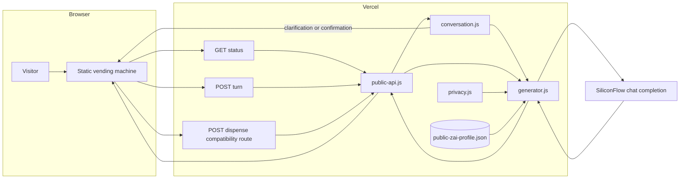

# Zai Vending Machine architecture

## System boundary

Zai Vending Machine is a public-only application. Its runtime has no Personal Brain, Obsidian vault, vector index, file watcher, private profile store, or owner administration surface.

The only personal context available to generation is the committed, owner-reviewed `config/public-zai-profile.json`. That file is derived manually from the supplied résumé, portfolio PDF, and public portfolio website after removing contact information, residential details, private relationships, and unsupported claims.

## Runtime diagram



## Agent design

The machine is a tool-using agent. At each step the model returns one JSON action, code executes it and returns an observation, and the loop repeats. Code never chooses the next step. It only enforces budgets, the privacy boundary, and the human checkpoints.

| Tool | Effect |
| --- | --- |
| `lookup_facts` | Reads up to three approved public facts by keyword or id. The prompt carries only a fact index, so details enter the context on demand |
| `ask_visitor` | Pauses and asks one question. Budget: two |
| `propose_plan` | Pauses for approval of the agent's reading and its product choice, which may differ from the visitor's |
| `write_draft` | Saves a draft. Blocked until the visitor has approved a plan |
| `self_review` | The agent critiques its own draft and may send itself back to rewrite. Required before presenting |
| `present_draft` | Pauses and shows the reviewed draft |

### Human in the loop

The loop stops at three points and resumes only on a visitor decision:

1. the agent's question, which the visitor can answer or hand back;
2. the plan, which the visitor can approve, correct (twice), or approve while keeping their original product;
3. the draft, which the visitor can accept or send back with feedback (twice). Feedback re-enters the loop as untrusted data.

Accepting the draft is deterministic: it dispenses the saved draft without another model call.

## Request lifecycle

1. The browser posts a thought and selected product to `POST /api/vending/turn`.
2. `public-api.js` validates the method, input, product, and process-local rate limit.
3. `conversation.js` screens extraction attempts. A match returns a sealed-hatch artifact with no model call.
4. `agent.js` runs the loop. Each model call sees the system prompt, the full trace so far, and visitor text as quoted untrusted data.
5. When the agent calls a human-checkpoint tool, the loop stops and the response carries an HMAC-signed ticket holding the whole agent state. The server stores nothing.
6. The visitor answers, approves, or sends feedback. Every visitor text is screened again before the loop resumes.
7. A request that spends its step or time budget returns `working`, and the browser immediately sends `continue`.
8. Drafts are cleaned (no paths, emails, URLs, wikilinks, code fences, or headings), word counted, and their traces resolved. Fact traces are kept only for facts the agent actually looked up.
9. On acceptance the browser receives the artifact and an agent log, and renders them as text.

## Source and deployment topology

The browser source lives in `public/vending/`. `scripts/build-vending.js` creates two static entry locations in `dist/`:

- `dist/index.html` for the deployment root;
- `dist/vending/` for the canonical asset paths used by the interface.

The three Vercel entry points are intentionally thin:

- `api/vending/status.js`
- `api/vending/turn.js`
- `api/vending/dispense.js`

They delegate to `src/vending/public-api.js`, which imports only deploy-safe modules. The production path does not import any local-development server code.

## Trust boundary

```text
OWNER-CONTROLLED CURATION                 PUBLIC RUNTIME

résumé ───────────┐
portfolio PDF ────┼─> manual review ──> public-zai-profile.json
portfolio website┘      and redaction                 │
                                                        ▼
visitor input ─────────────────────────────────> generator ──> model
                                                        │
                                                        ▼
                                          validated artifact + traces
```

No automated pipeline copies source documents into the profile. This deliberate manual boundary prevents a deployment from silently ingesting new private material.

## Privacy controls

### Input controls

- Request bodies must be valid JSON.
- Input must be a string between 2 and 1,200 characters.
- Clarification replies must be between 1 and 600 characters.
- Product identifiers must match the fixed product catalog.
- Common extraction and instruction-override attempts receive a safe artifact without a model call.
- Tickets are HMAC-signed, length bounded, and expire after 20 minutes. They carry the agent state, which the client can read but not change.

### Prompt controls

- Visitor input is wrapped as data, not appended as system instructions.
- Confirmed context is also wrapped as data and cannot alter system rules.
- The prompt explicitly forbids private-memory claims, file access, tool use, and unsupported personal facts.
- Questions about Zai must be grounded in owner-approved public facts.

### Output controls

- The model must return JSON.
- Titles and messages are length bounded.
- Suspicious paths, contact strings, URLs, Markdown headings, and code fences are rejected.
- Behavioral and fact trace IDs are resolved against the approved profile; invented IDs are discarded.

## Data and external services

| Component | Data handled | Persistence |
| --- | --- | --- |
| Browser | Visitor input, signed ticket, generated artifact | Browser state only |
| Vercel function | Request, confirmed context, selected public facts, generated artifact | None in this repository |
| SiliconFlow | Prompt and generated completion | Governed by the provider |
| Public profile | Approved public facts and behavioral traits | Committed JSON |
| Rate limiter | Request timestamps keyed by IP | Process memory only |

## Known limits

- In-memory rate limiting is not coordinated across Vercel instances.
- Signed tickets prevent client-side changes but are replayable until their 20-minute expiry.
- Public-profile updates require manual review and deployment.
- A valid trace ID proves that the response selected an allowlisted record; it does not independently verify the underlying source claim.
- Safety is layered prompt and application validation, not a formal non-disclosure guarantee.
- The application is prompt-grounded generation, not fine-tuning or persistent learning.
